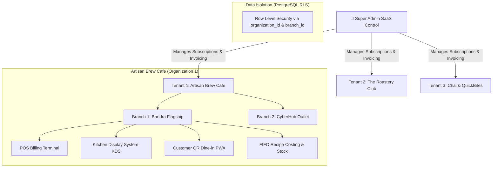

# Multi-Tenant Cafe POS & ERP SaaS — Master Production Blueprint

This blueprint outlines the complete architecture, data models, and functional specifications of the **Restaurant & Cafe POS ERP SaaS Platform**, engineered specifically for multi-tenant subscription deployment across multiple independent cafe brands and outlets.

---

## 1. SaaS Multi-Tenancy Architecture

### 1.1 Multi-Tenant Data Isolation
* Every database record is partitioned by `organization_id` (the cafe enterprise) and `branch_id` (the physical outlet).
* PostgreSQL **Row-Level Security (RLS)** guarantees that Cafe A can NEVER view or mutate Cafe B's transactions, customers, recipes, or cash drawers.
* **Supabase Realtime channels** are namespaced per branch: `branch-kds-${branchId}`, `branch-tables-${branchId}`, `branch-pos-${branchId}`.

---

## 2. Core Scoped Feature Modules (Exact 11 Requirements)

### Module 1: Table & Reservation Management
* **Visual Floor Plan Canvas:** 2D interactive floor plan layout with capacity, coordinates, and shape (Square, Round, Rectangle).
* **Live Table States:**
  * `AVAILABLE` (Emerald green)
  * `OCCUPIED` (Crimson red with live running bill indicator)
  * `BILL_REQUESTED` (Flashing cyan blue alert upon guest QR request)
  * `RESERVED` (Purple)
* **Table Operations:** Occupy, Vacate, and seamless **Table Transfer** (transfers live items and bill from Table A to Table B with 1 click).
* **Guest Waitlist:** Queue manager with party size, phone number, estimated wait time, and 1-click "Seat Guest at Table X".
* **Reservations:** Advance booking calendar with guest requests and table allocations.

### Module 2: Kitchen Display System (KDS)
* **Multi-station Ticket Routing:** Automatic item category routing to designated kitchen screens (e.g., *Coffee Bar*, *Hot Grill*, *Bakery & Desserts*).
* **Live Kanban Board:** Columns for `PENDING`, `PREPARING`, `READY TO SERVE`, and `BUMPED`.
* **Dynamic Prep Timers:**
  * Green: 0–10 mins (On Schedule)
  * Amber: 10–20 mins (Moderate Rush)
  * Red (Flashing Urgent): > 20 mins (Late alert)
* **Chef Actions:** Item strike-through (cross off finished dish items), reprint KOT slip, advance status, and bump ticket.
* **KDS Analytics:** Average station prep speed, fastest ticket, slowest ticket, and count of late orders.

### Module 3: Menu & Modifier Management
* **Hierarchies:** Category $\rightarrow$ Menu Dish $\rightarrow$ Modifier Groups (Single-select / Multi-select) $\rightarrow$ Options with price additions.
* **Combos & Meals:** Bundle sets (e.g., Morning Coffee + Croissant Combo).
* **Instant Out-of-Stock Toggle:** 1-click toggle that instantly disables dishes across POS terminals and Customer QR menus in real-time.
* **Recipe Costing Integration:** Displays ingredient food cost and gross profit margin percentage directly on each dish card.

### Module 4: Inventory & Store Management
* **Raw Ingredients:** Units of measure (kg, g, l, ml, pcs), current stock balances, reorder thresholds, and average unit costs.
* **Recipe Costing Formulation:** Granular recipe breakdown (e.g. 18g espresso beans + 220ml milk = ₹34.76 recipe cost for Flat White).
* **Automatic Consumption:** Stock is deducted automatically upon kitchen order routing.
* **FIFO Waste Logging:** Log wasted/spoiled milk, burnt roasts, or dropped food with reason codes and automated financial loss calculations.

### Module 5: Procurement & Vendor Management
* **Suppliers Directory:** Vendor contact details, GSTIN, credit payment terms (7, 15, 30 days), and supplier quality ratings (1–5 stars).
* **Purchase Orders (PO):** Issue POs with line items, delivery dates, and status tracking (`DRAFT`, `SENT`, `RECEIVED`).
* **Goods Receipt Notes (GRN):** Record goods received against POs with vendor invoice numbers and inventory batch intake.

### Module 6: CRM, Loyalty & Referral Rewards
* **Customer Profiles:** Phone-based CRM tracking visit count, lifetime spend, favorite items, and birthday/anniversary dates.
* **Loyalty Points Engine:** Configurable earn rate (e.g. 5% cashback in points) and instant checkout redemption.
* **Referral Program:** Unique 8-digit referral codes generated for each customer; bonus points awarded to both referrer and friend upon first order.
* **Gift Vouchers:** Generate branded digital vouchers (e.g., `WELCOME100`, `BREWBEST500`) with balance tracking.
* **Guest Feedback:** Post-meal star ratings for Food, Service, and Ambience with customer comments.

### Module 7: Staff Management, Attendance & Tip Pool
* **Staff Accounts & RBAC:** Roles for Branch Manager, Cashier, Waiter, Kitchen Chef, and Storekeeper with hourly pay rates.
* **PIN-Based Terminal Clock In/Out:** Attendance logs with exact timestamps, total hours, and overtime calculations.
* **Shift Scheduling:** Shift templates with clash checks and handover buffers.
* **Equitable Tip Pool Splitter:** Aggregates daily collected tips and automatically splits them proportionally among on-duty staff based on their exact clocked hours.

### Module 8: Accounting, Expenses & Day-End Cash Close
* **Nightly Cash Close Terminal:** Reconciles physical cash drawer against system transactions:
  $$\text{Expected Cash} = \text{Opening Float} + \text{Cash Sales} - \text{Petty Cash Expenses} - \text{Cash Refunds}$$
  Highlights exact **Variance (Shortage or Surplus)** for theft prevention and manager audit sign-off.
* **Petty Cash Expenses:** Categorized log of daily operational disbursements (LPG gas, lemons/mint, equipment maintenance).
* **Monthly Budgets vs Actual:** Visual budget utilization progress bars per expense category.
* **Profit & Loss Statement (P&L):** Accrual financial summary covering Gross Sales, COGS, Gross Margin %, Operating Expenses, and Net Operating Profit.
* **India GST Tax Summary:** CGST 2.5% + SGST 2.5% liability reports exportable for monthly GST return filing.

### Module 9: Online QR Dine-in & Ordering PWA
* **Table QR Self-Ordering:** Smartphone web view where guests browse photos, select modifiers, and submit orders directly to kitchen KDS.
* **Call Waiter Chime:** Interactive button that instantly sounds an audio chime and pops an alert on the cashier/manager top bar.
* **Request Bill Button:** Flags table status to `BILL_REQUESTED` without needing to flag down busy servers.

### Module 10: Analytics & 18 Reports
* **Live KPI Dashboard:** Today's Sales, Orders Count, Occupancy %, Average Prep Speed, and Cash vs UPI Tender breakdown.
* **Peak Hours Heatmap:** Visual footfall and revenue heatmap across 2-hour time slots to optimize staff scheduling.
* **Menu Sales Velocity:** Ranked list of best-sellers, quantities sold, revenue, raw food cost, and profit margins.
* **Customer Retention Metrics:** Total registered guests, new customer acquisition rate, and repeat customer percentage.
* **1-Click CSV Export:** Export any report to clean CSV/Excel spreadsheets.

### Module 11: Branch Governance & Dynamic UPI Configuration
* **Per-Branch Tax Regime:** Switch between GST 5%, 12%, 18%, or Tax-Inclusive pricing modes.
* **Dynamic NPCI UPI Payee QR:** Configurable merchant VPA (e.g. `yourcafe@icici`) and payee name that dynamically renders exact UPI payment strings on POS bills and customer checkouts:
  $$\text{upi://pay?pa=VPA\&pn=NAME\&am=AMOUNT\&cu=INR\&tn=BILL\_REF}$$
* **Role Permissions:** Granular access controls per staff designation.

---

## 3. Database Schema File Reference

The complete production SQL migration is stored at:
[supabase/migrations/001_initial_schema.sql](file:///d:/juned%20project/restaurantPOS/supabase/migrations/001_initial_schema.sql)

It includes:
1. `organizations`, `branches` (Tenancy, GSTIN, UPI VPA)
2. `app_users`, `roles` (RBAC & PIN auth)
3. `floors`, `tables`, `waitlist`, `reservations`
4. `kitchen_stations`, `kot_tickets`, `kot_items`
5. `menu_categories`, `menu_items`, `modifier_groups`, `modifier_options`
6. `orders`, `order_items`, `order_item_modifiers`, `payments`
7. `table_guest_requests` (Call waiter / Request bill)
8. `inventory_items`, `recipes`, `recipe_ingredients`, `waste_logs`
9. `suppliers`, `purchase_orders`, `goods_receipt_notes`
10. `customers`, `loyalty_transactions`, `gift_vouchers`, `customer_feedback`
11. `shifts`, `attendance_logs`, `tip_pools`, `tip_distributions`
12. `cash_closings`, `expenses`, `monthly_budgets`
13. Supabase Realtime publication setup and Row-Level Security policies.
