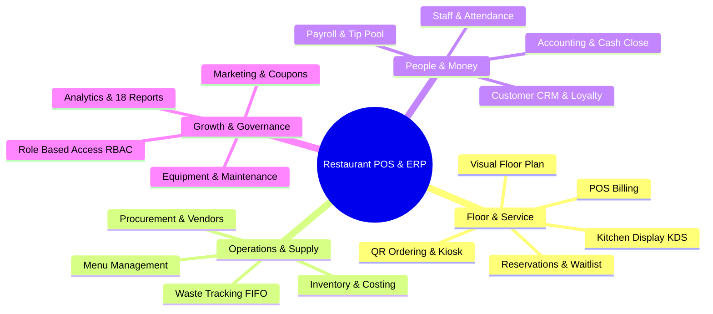
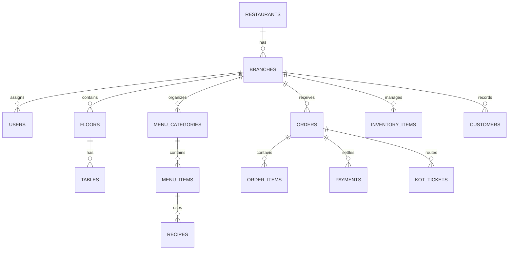

# Restaurant POS & ERP — Angular + Supabase Master Blueprint

This blueprint captures the complete architectural, functional, and UI/UX specification of the Restaurant POS & Management System (`nodedr-orderrestro`), translated to an **Angular (v19+ Standalone & Signals) + Supabase (PostgreSQL, Auth, Realtime, Storage)** architecture.

---

## 1. Tech Stack Translation

| Component | Original Stack (Repo) | New Target Stack |
|---|---|---|
| **Frontend Framework** | Next.js 16 (React 19) + App Router | **Angular 19+** (Standalone Components, Signals, RxJS) |
| **State Management** | TanStack Query + Zustand / Local State | **Angular Signals** + Computed Signals + Resource API |
| **Styling & Design** | Tailwind CSS v4 + Base UI (shadcn) | **Tailwind CSS v4** + Custom Components / Lucide Angular |
| **Icons** | Lucide React | **Lucide Angular** |
| **Database** | Self-hosted PostgreSQL 16 + Prisma | **Supabase Hosted PostgreSQL** |
| **Realtime / Live Updates**| NestJS Socket.IO Gateway | **Supabase Realtime (PostgreSQL Changes & Broadcast Channels)** |
| **Authentication & RBAC** | Custom JWT (httpOnly cookie) + NestJS Guards | **Supabase Auth** + Postgres RLS + Custom RBAC Claims / Table |
| **File Storage** | Local Disk (`/data/uploads`) | **Supabase Storage** (`menu-items`, `receipts`, `documents`) |
| **Hosting & Deployment** | Docker Compose / VPS | **Vercel / Netlify / Cloudflare Pages** (Frontend) + **Supabase Cloud** (Backend) |

---

## 2. Complete Module Breakdown (All 20 Modules)



### Module 1: Point of Sale (POS) & Billing
* **Order Types:** Dine-in, Takeaway, Quick Sale, Delivery, QR Table Order.
* **Menu Grid:** Category tabs, search with shortcut keys, item cards with modifier popup (sizes, add-ons, spice level, special instructions).
* **Cart Operations:** Quantity increment/decrement, line-level discount, order-level discount (percentage or flat), customer attachment.
* **Split Bill:** Split by seat/item, split equally across N persons.
* **Tax Calculation:**
  * India GST: 5% (2.5% CGST + 2.5% SGST) or custom slabs (12%, 18%).
  * Inclusive vs. Exclusive pricing presets.
* **Payment Tender:** Cash (with change return calculator), UPI QR code (dynamic NPCI intent string), Card, Split tender (Cash + UPI), Loyalty points redemption, Gift vouchers.
* **Receipt Printing:** Printable receipt template (58mm / 80mm ESC/POS format or browser Print Dialog).

### Module 2: Table & Floor Management
* **Visual Floor Plan:** Drag-and-drop table layout per floor/section (Indoor, Terrace, Bar).
* **Table States:** `AVAILABLE` (green), `OCCUPIED` (red/amber), `BILL_REQUESTED` (blue), `RESERVED` (purple).
* **Table Operations:** Occupy, Open KOT, Transfer Table, Merge Tables, Call Waiter alert indicator.
* **Waitlist Management:** Party size, contact number, estimated wait time, SMS/status flag.

### Module 3: Kitchen Display System (KDS)
* **Realtime Live Board:** KOTs organized into columns (Pending, Preparing, Ready, Served).
* **Multi-station Routing:** Grill, Bar, Fryer, Bakery, Main Kitchen stations automatically split items based on item category.
* **Ticket Card UI:** Table number, server name, order timer with color stages:
  * Green: 0–10 mins
  * Amber: 10–20 mins
  * Red (Flashing/Urgent): > 20 mins
* **Actions:** Item strike-through, complete ticket, bump ticket, reprint KOT.

### Module 4: Menu Management
* **Hierarchies:** Categories $\rightarrow$ Menu Items $\rightarrow$ Modifier Groups (Single-select / Multi-select) $\rightarrow$ Options.
* **Combos:** Combo meals with selection groups (e.g., "Choose 1 Burger + 1 Drink + 1 Side").
* **Availability Schedules:** Breakfast, Lunch, Dinner menus; out-of-stock toggle with instant realtime propagation to POS/QR.

### Module 5 & 6: Inventory, Costing & Procurement
* **Ingredients:** Unit of measure (kg, g, l, ml, pcs), reorder threshold, weighted-average unit cost.
* **Recipes:** Sub-recipes and ingredient mapping per menu item.
* **Automatic Consumption:** Stock deducted upon order completion (allows negative stock with warning flag to never block billing).
* **Waste Logging:** FIFO batch deduction (oldest batches consumed first for accurate cost-of-waste).
* **Procurement Cycle:** Purchase Request $\rightarrow$ Supplier Quotation $\rightarrow$ Purchase Order (PO) $\rightarrow$ Goods Receipt Note (GRN) with batch/expiry $\rightarrow$ Supplier Invoice & Payment.

### Module 7: CRM, Loyalty & Referrals
* **Customer Profile:** Spend history, favourite items, visit frequency, lifetime value (LTV).
* **Loyalty Engine:** Configurable earn rate (e.g. 1 point per ₹100 spend) and redemption value (1 pt = ₹1).
* **Referrals:** Sharer gets bonus points, referee gets discount on first order above minimum spend.

### Module 8: Staff, Attendance & Payroll
* **Clock In / Out:** PIN-based attendance terminal.
* **Shifts:** Schedule shifts, clash detection, overtime tracking.
* **Payroll:** Computed from clocked hours minus unpaid leave; Tip pool distribution proportional to hours worked.

### Module 9 & 15: Accounting & Nightly Cash Closing
* **Cash Closing (Day End):** Expected cash in drawer (opening balance + cash sales - cash refunds - petty expenses) vs. actual counted cash $\rightarrow$ Variance calculation with audit record.
* **Expenses:** Category-wise petty cash and operational expenses.
* **Financial Statements:** P&L summary, Tax liability summary (CGST/SGST collected vs paid on purchases).

### Module 11: Guest QR Ordering & Self-Service Kiosk
* **QR Table Ordering:** Table-specific QR token; guests browse menu, add modifiers, submit order, call waiter, or request bill directly from smartphone browser without installing any app.
* **Kiosk Mode:** Fullscreen touch terminal for takeaway / dine-in orders with UPI QR payment.

### Module 13: Analytics & Reporting
* 18 Standard Reports: Sales summary, peak hours heatmap, category/item sales velocity, staff sales performance, food cost percentage, table turnover rate, tax report, export to CSV/Excel/PDF.

### Module 18: Security & RBAC
* Fine-grained permissions: `orders.create`, `orders.discount`, `menu.edit`, `reports.view`, `cash_close.manage`, etc.
* Override capabilities per user on top of role.

---

## 3. UI/UX Design System Specification

### Color Tokens

```css
/* Light Mode */
--background:         #FAFAFA;
--surface:            #FFFFFF;
--sidebar:            #FCFCFC;
--foreground:         #111827;
--muted-foreground:   #6B7280;
--border:             #E5E7EB;
--primary:            #9F1239; /* Wine/Burgundy - hospitality accent */
--primary-foreground: #FFFFFF;
--secondary:          #6D4AFF; /* Action violet */
--success:            #22C55E;
--warning:            #F59E0B;
--danger:             #EF4444;

/* Dark Mode */
--background:         #0B0B0D;
--surface:            #151517;
--sidebar:            #111113;
--foreground:         #F4F4F5;
--muted-foreground:   #9CA3AF;
--border:             #26262A;
--primary:            #FB7185; /* Bright Rose for dark contrast */
--primary-foreground: #1F0A0F;
--success:            #34D399;
--warning:            #FBBF24;
--danger:             #F87171;
```

### Typography & Spacing
* **Font Family:** `Geist` or `Inter`, system fallback.
* **Radius:** `12px` default, `16px` for cards, `9999px` for pills/badges.
* **Layout Structure:**
  * Collapsible Sidebar (icons + labels, collapses to bottom bar / drawer on mobile).
  * Top Bar: Restaurant & Branch selector, Global search (`Ctrl+K`), Quick clock-in/out button, Notification bell, Dark/Light mode toggle, User avatar.
  * POS Screen: 65% Menu Grid (Categories + Dish Cards) / 35% Active Cart panel.
  * KDS Screen: High-contrast fullscreen kanban board with dynamic ticket countdown clocks.

---

## 4. Supabase Data Model (PostgreSQL)



### Key Supabase Tables
1. `restaurants` & `branches` (Tenancy, currency, timezone, tax regime, UPI VPA).
2. `users`, `roles`, `permissions`, `role_permissions` (Supabase Auth `auth.users` linked to public `users`).
3. `floors`, `tables` (Coordinates `x`, `y`, shape, capacity, status, QR token).
4. `menu_categories`, `menu_items`, `modifier_groups`, `modifier_options`, `combos`.
5. `orders`, `order_items`, `order_item_modifiers`, `kot_tickets`, `payments`.
6. `customers`, `loyalty_transactions`, `coupons`.
7. `ingredients`, `recipes`, `stock_batches`, `waste_logs`, `purchase_orders`.
8. `attendance`, `shifts`, `payroll_runs`, `cash_closings`.

### Realtime Architecture (Replacing Socket.IO)
In Angular, we listen to Supabase Realtime channels:
* `channel('branch-kds-${branchId}')` $\rightarrow$ Listens to INSERT/UPDATE on `kot_tickets` and `orders`.
* `channel('branch-tables-${branchId}')` $\rightarrow$ Listens to status updates on `tables` (vacant, occupied, bill requested).
* `channel('branch-pos-${branchId}')` $\rightarrow$ Listens to waiter calls and online/QR order alerts with audio chimes.

---

## 5. Angular Application Architecture

```
apps/angular-pos/
├── src/
│   ├── app/
│   │   ├── core/
│   │   │   ├── services/
│   │   │   │   ├── supabase.service.ts       # Supabase client singleton
│   │   │   │   ├── auth.service.ts           # Supabase Auth signal state
│   │   │   │   ├── realtime.service.ts       # Supabase Realtime Channels
│   │   │   │   ├── sound.service.ts          # Chimes for KOT/payment received
│   │   │   │   ├── print.service.ts          # ESC/POS & HTML receipt generator
│   │   │   │   └── tax-calculator.service.ts # India GST inclusive/exclusive math
│   │   │   ├── guards/
│   │   │   │   ├── auth.guard.ts
│   │   │   │   └── permission.guard.ts
│   │   │   └── models/                      # Full TypeScript interfaces & DTOs
│   │   ├── shared/
│   │   │   ├── components/                  # Buttons, Modals, Inputs, Data Tables
│   │   │   └── pipes/                       # Currency INR (₹), TimeAgo, TaxFormatter
│   │   └── features/
│   │       ├── pos/                         # POS Billing Screen (Cart, Modifiers, Split)
│   │       ├── kds/                         # Kitchen Display Screen (Live tickets)
│   │       ├── tables/                      # Visual Floor Plan & Waitlist
│   │       ├── menu/                        # Category, Dish, Modifier management
│   │       ├── inventory/                   # Ingredients, Recipes, Waste, POs
│   │       ├── crm/                         # Customers, Loyalty points, Referrals
│   │       ├── reports/                     # Sales, Tax, P&L, Staff analytics
│   │       ├── staff/                       # Attendance, Shifts, Payroll
│   │       ├── finance/                     # Daily Cash Close, Expenses
│   │       ├── qr-guest/                    # Customer Mobile QR Menu & Ordering
│   │       └── settings/                    # Branch details, Tax mode, UPI setup
```

---

## 6. Implementation Milestones

1. **Phase 1: Foundation & Supabase Setup**
   * Supabase database schema migration (DDL, Enums, RLS policies).
   * Angular 19 initialization with Tailwind v4, Lucide icons, and Supabase client.
   * Supabase Auth + Pin quick-login + Branch context switch.
2. **Phase 2: Menu, Tables & Core POS Billing**
   * Menu & Modifiers management with image uploads to Supabase Storage.
   * Visual table designer & table occupancy state.
   * Full POS billing interface, discount engine, GST calculation, and cash/UPI tender with dynamic QR.
3. **Phase 3: Realtime KDS & Printing**
   * KDS Kanban board powered by Supabase Realtime.
   * Automatic KOT routing to kitchen stations.
   * Thermal receipt & KOT printing engine.
4. **Phase 4: Inventory, Costing & Procurement**
   * Ingredient setup, recipe formulation, automatic stock deduction, FIFO waste log.
   * Purchase order and GRN workflow.
5. **Phase 5: CRM, Staff, Reports & Day-End Cash Close**
   * Customer loyalty & referral reward logic.
   * Staff clock-in/out, shift management, payroll calculations.
   * Cash closing reconciliation & 18 exportable reports.
